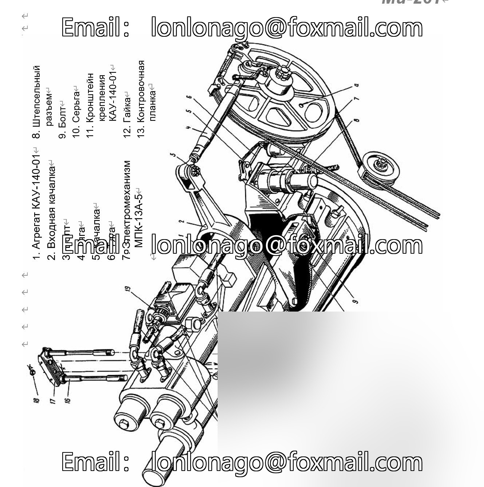
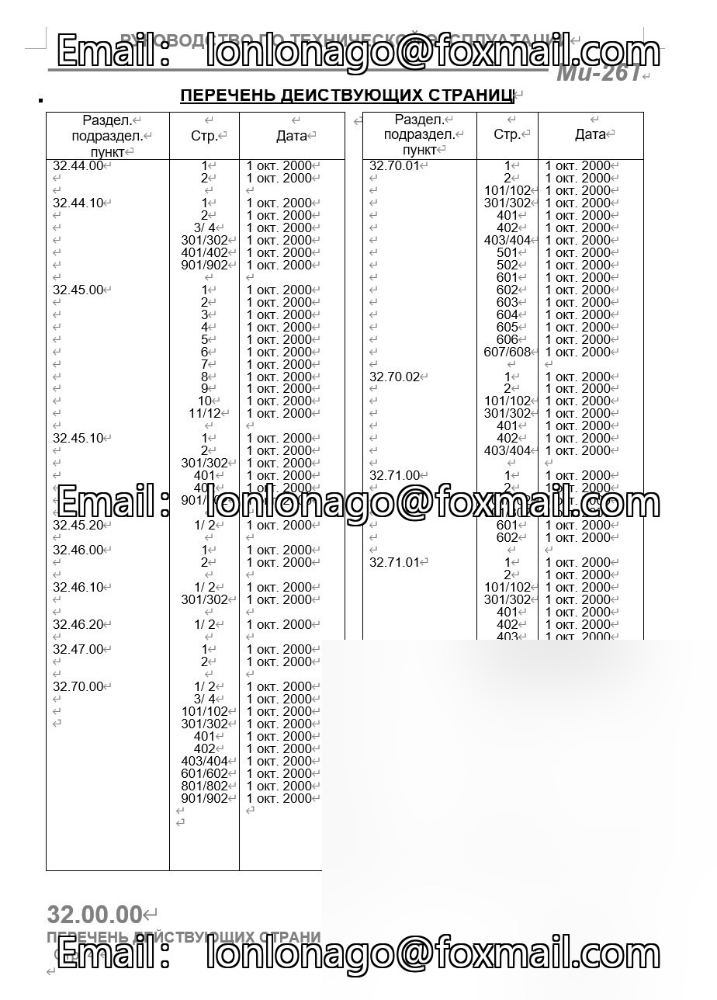
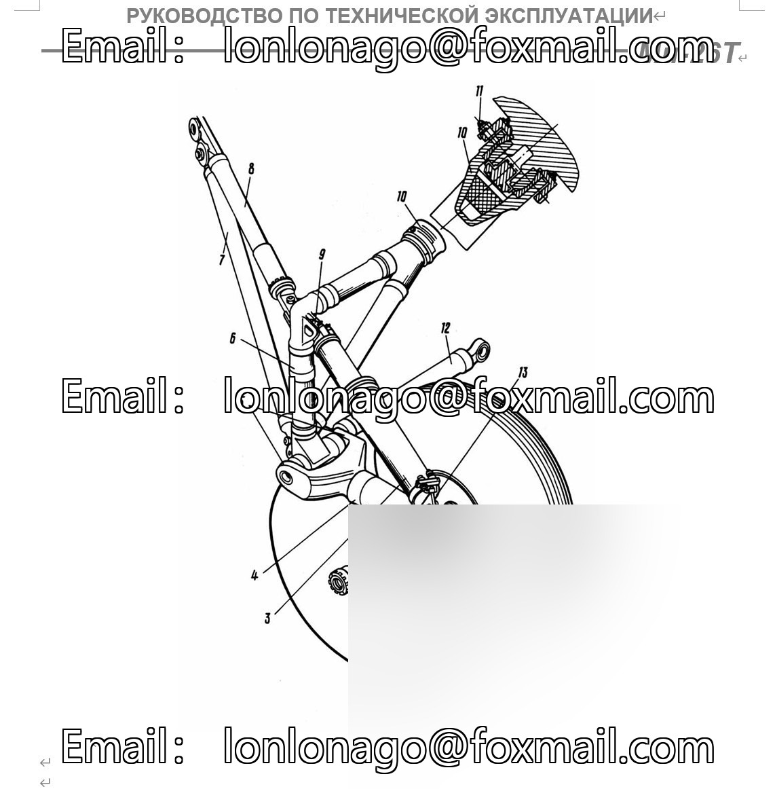
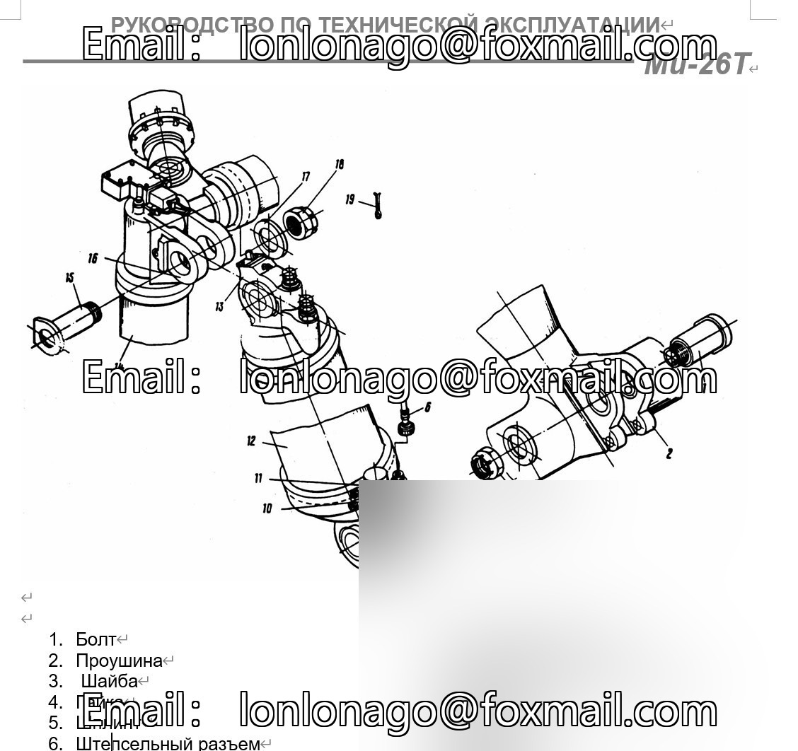
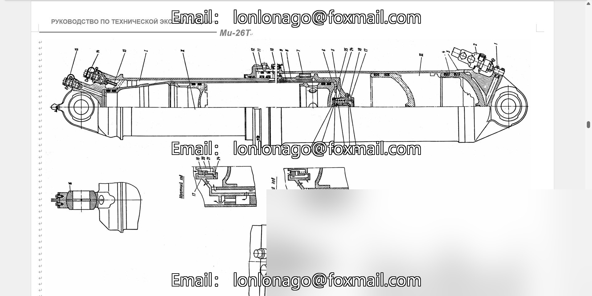
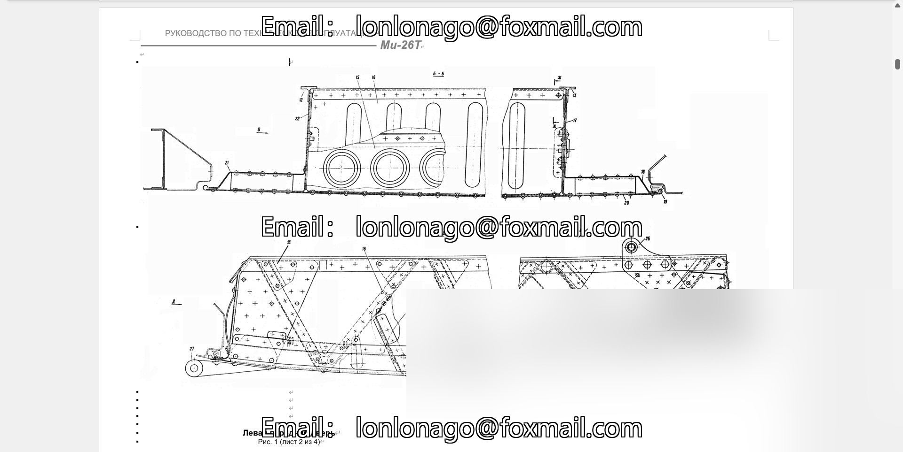

# Mi-26T helicopter design materials

## Body

M-26T helicopter design materials; M-26T heavy transport helicopter technical manual, Russian original, electronic Word file, approximately 165 files.
Content covers wheels, brakes, landing gear, leveling and shock absorbers, fuel system, daily equipment, tail rotor, fire equipment, hydraulic system, wing girder damage detection, with strong systematicity, suitable for maintenance, upkeep, and reference for study.

The materials are in word format, and the direct link is sent to the cloud drive.

The design materials include a M26T helicopter, technical manuals and multiple chapters such as wheel, brake, landing gear, tilt-shock, fuel system, life equipment, tail rotor, fire equipment, hydraulic system and wing panel damage detection.

<!-- AI_ENRICHED -->

## Images

## Payment

Here is a pay link on Stripe ( https://buy.stripe.com/3cs8yP7sY87d0vu9AB ). Please contact me lonlonago@foxmail.com after funding $89, and I will send you a complete data files , thank you!

